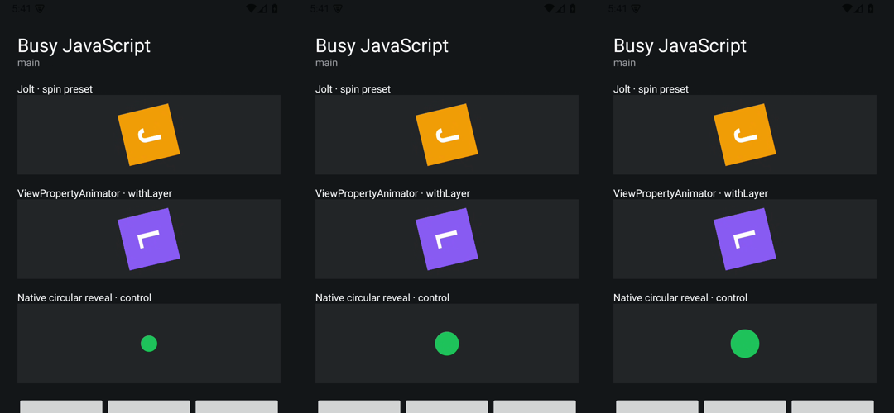

# Android busy JavaScript diagnostic — 2026-10-15

Android 15 / API 35 ARM64 emulator, 60 Hz. Release/production build, no HMR, Animator duration scale 1x. Jolt 0.1.0-beta.4, Core 9.1.3, Android runtime 9.1.1. This is an emulator diagnostic, not physical-device performance evidence.

Measured commit: `8fa5ed2f68cbf6f1e87f983d3916045785bebbd5` (clean checkout). Busy-source SHA-256: `08ec4c05a0edf6d24b58de4b8640c84ad2ff741e75d424ebec5d15807529e00d`. Build/device metadata, all nine app reports and summaries are in the [JSON](./2026-10-15-android-busy.json); selected raw native timing columns are in the [CSV](./2026-10-15-android-busy.csv).

Each trial runs a Jolt spin preset, the same rotation with native withLayer(), and a native circular reveal for 1800 ms. At 400 ms, idle waits; main blocks JavaScript for 300 ms; worker runs the identical CPU-loop function off-thread. Worker startup is excluded. Three runs per mode, with rotated order.

| Mode   | Native UI records | Median maximum UI gap overlapping work (ms) | Maximum UI gap anywhere (ms) | Median Jolt rotation during work | Median withLayer rotation during work |
| ------ | ----------------: | ------------------------------------------: | ---------------------------: | -------------------------------: | ------------------------------------: |
| idle   |               327 |                                       16.67 |                        16.67 |                           60.00° |                                60.00° |
| main   |               273 |                                      316.67 |                       316.67 |                            0.00° |                                 0.00° |
| worker |               325 |                                       16.67 |                        33.33 |                           60.00° |                                60.00° |

Both native rotations stayed unchanged between the reads immediately before and after every main-thread block, despite withLayer being active (layer type 2). In the worker trials, native thread IDs differed from the main runtime and both rotations advanced. Layer type returned to 0. Cancellation during worker preparation and active playback passed the preflight checks.

The main trials had 300–316.67 ms gaps between recorded UI intended vsyncs. Two of those trials nevertheless reported a maximum individual recorded frame duration below 20 ms: Android can skip vsyncs, so frame duration alone can hide the pause. Two worker trials had a 33.33 ms gap outside the work window; the worker result does not imply every frame was perfect.

These are UI-window gfxinfo records and two native property reads, not a RenderThread FPS or presentation-latency measurement. A separate screen recording checks the reveal visually; it is not used in the primary frame collection. See the [method and reproduction commands](../android-busy.md).

## Separate visual control

A screen recording of the same build was decoded at 60 fps. In 16 decoded frame intervals (0.27 s of nominal decoded intervals), the orange and purple tile masks changed by fewer than 50 pixels while the green reveal area grew by more than 50 pixels per interval. The native rotations stayed visually fixed while the circular reveal continued. This is a pixel observation of this emulator, not a general animation-backend guarantee. The JSON includes the per-interval counts.

